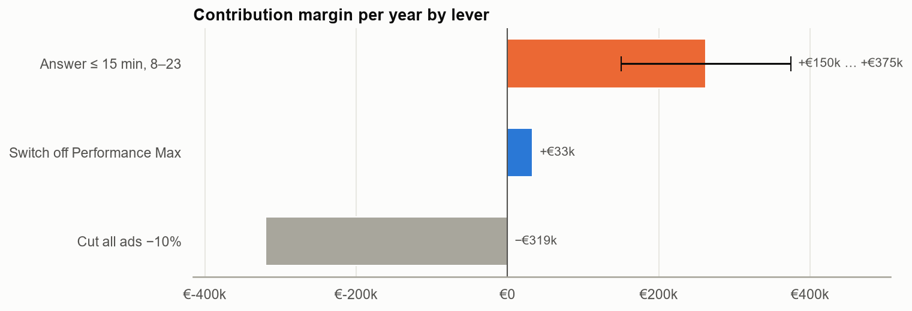
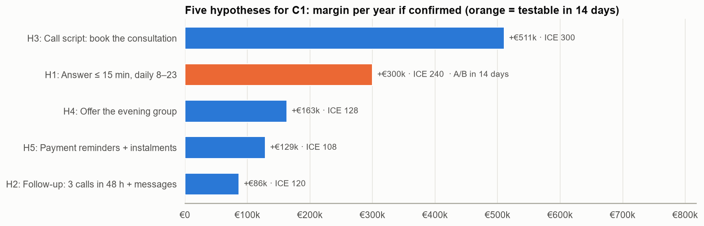

# CRM Analytics for an Online Programming School

End-to-end data analysis of a real CRM export (leads, calls, ad spend and deals) for an online IT school in Germany: data cleaning, exploratory analysis, unit economics, a metric tree, five hypotheses for conversion (C1) growth and an A/B test design.

**Stack:** Python · pandas · NumPy · matplotlib · seaborn · SciPy · statsmodels · Jupyter · Plotly.js

| | |
|---|---|
| Interactive dashboard | [`reports/dashboard.html`](reports/dashboard.html) |
| **Tableau Public (live)** | [CRM Dashboard](https://public.tableau.com/app/profile/yerkovska.yuliia/viz/crm_dashboard/CRMDashboard) · [A/B Test Options](https://public.tableau.com/app/profile/yerkovska.yuliia/viz/crm_dashboard/ABTestOptions) |
| Tableau dashboard (Tableau Cloud, packaged workbook) | [`reports/tableau/crm_dashboard.twbx`](reports/tableau/crm_dashboard.twbx), built by `src/export_tableau.py` + `src/build_tableau.py`. Data model: Deals ⟕ Contacts and Deals ⟕ Calls on Contact ID, Deals ⟕ Spend on Source + Month (one row per lead, ad spend spread with a FIXED LOD); second dashboard *A/B Test Options* shows the product hypotheses and the 14-day MDE of four test designs for each (`src/build_ab_variants.py`) |
| Presentation (12 slides in Russian, speaker notes included) | [`reports/presentation.pptx`](reports/presentation.pptx) |
| Full report (rendered notebooks) | [`reports/html/`](reports/html) |
| **Answer to the business question** | [`notebooks/04_conclusions.ipynb`](notebooks/04_conclusions.ipynb) · [HTML](reports/html/04_conclusions.html) |

## Business question

The school spends about €150k a year on ads and gets about 20k leads. Only 4.2% of them become paying students. **Where are sales lost, and what is the cheapest lever to grow profit?**

## Short answer

1. **Sales are lost at first contact and qualification, not on price.** 31% of leads never talk to a manager and only 17% reach a consultation. After a consultation the funnel works: 72% of invoices are paid.
2. **The sales team did not keep up with growth.** Leads tripled, answers within 15 minutes fell from 21% to 3%, and conversion fell *inside* every channel (channel mix explains < 0.2 pp).
3. **The growth lever is C1, with five hypotheses, one per funnel step**: response speed, follow-up touches, call script, evening group, payment reminders. None needs ad budget. **Speed of first response (H1) goes into the A/B test first**: it is the only one a 14-day test can detect, worth **+€150–375k contribution margin a year** if confirmed. The call script has the biggest potential (H3, ≈ +€511k) and is the next test. Switching off one Performance Max campaign saves another ≈ €33k right away.



## Key results

| Metric | Value |
|---|---|
| Leads (after cleaning) | 19,822 |
| Students | 837 |
| Lead → student conversion (C1) | 4.22% |
| Cash received | €3.58M |
| Revenue recognised (months studied) | €3.34M |
| CAC | €179 |
| Revenue per student (CLTV) | €3,996 |

1. **Most sales are lost at first contact, not on price.** Funnel: lead → call 87% → conversation 69% → consultation 17% → invoice 5.6% → student 4%. 40% of lost deals are "doesn't answer / stopped answering".
2. **Speed matters.** Leads answered within 15 minutes are reached by phone 77% of the time, against 59% for responses between 15 minutes and 24 hours (χ², p < 0.001). Controlling for source, hour, weekday, month and manager in a logistic regression, the gap is +19 pp (95% CI +15…+23 pp).
3. **Growth broke conversion — through the sales process, not the traffic.** Lead volume tripled while C1 fell from 5–6% to 2.6–3.4%. A shift-share decomposition by source puts +0.1 pp of the −2.3 pp on channel mix and −2.4 pp inside channels; the share of answers within 15 minutes fell from 21% to 3%.
4. **Marketing.** Facebook brings the most leads with a CAC of €172. Google Ads' CAC of €344 comes from one Performance Max campaign (€34k, 23% of budget, 1 student); without it Google Ads' CAC is ≈ €141.
5. **Product.** Digital Marketing brings 57% of students. Evening groups convert almost twice as well as morning groups.
6. **Unit economics.** All products are profitable after marketing. +10% to C1 adds €334k contribution margin without extra ad spend.

**Five hypotheses for C1** (notebook 03, section 4). C1 is the product of the funnel steps, so each hypothesis targets one step; the effect is estimated from the data with conservative assumptions and prioritised with ICE:

| | Hypothesis | Funnel step | Margin / year | ICE | A/B in 14 days |
|---|---|---|---|---|---|
| H3 | Call script: book the consultation in the first call | conversation → consultation | +€511k | 300 | no (~87 days) |
| H1 | Answer ≤ 15 min, daily 8–23, + message to the client | lead → conversation | +€300k | 240 | **yes (9 days)** |
| H4 | Offer the evening group at every consultation | consultation → invoice | +€163k | 128 | no |
| H2 | 3 calls in 48 h + WhatsApp/SMS to leads not reached | call → conversation | +€86k | 120 | no (~43 days) |
| H5 | Payment reminders after 24/72 h + instalments | invoice → payment | +€129k | 108 | no |

H1 goes into the A/B test now, H3 is the next test, H2, H4 and H5 are checked as pilots.



**Unit reconciliation.** The teacher's calculation counts people (UA = 18,548 Contacts rows, C1 = 4.47%); this project counts requests (19,822 deals, C1 = 4.22%), because the A/B test randomises requests. Margin and the +10% C1 effect are identical for both units, and every node of the teacher's metric tree (CM = (CLTV − CLTC) × B = UA × (LTV − LTC), LTV = CLTV × C1, CLTV = (AOV − COGS) × APC) is in ours.

**Hypothesis H1 and test design:** auto-assign every new lead to a manager within 1 minute and call within 15 minutes, **every day from 8:00 to 23:00**. This should raise the 24-hour reach rate by at least 10 percentage points. The test is designed only (the CRM has no experiment data). The duration is fixed at 14 days. The expected effect is estimated from the data (slow leads in the window get the reach rate of fast leads): +12.2 pp. The window covers 85% of leads, 442 per group, baseline 42.2%, so the minimum detectable effect is +9.4 pp (α = 0.05, power = 80%, two-proportion z-test). The rule must reach at least ~80% of test leads; in office hours only (Mon–Fri 9–18, 41% of leads) the test could not detect the effect (MDE +13.6 pp vs +11.0 pp). C1 is checked after 45 days. Expected impact if confirmed: +€150–375k contribution margin per year (three scenarios for compliance and how much of the reach gap carries into C1).

**Product hypotheses:** Digital Marketing — offer an evening group at every consultation (evening 47.6% vs morning 32.9% reach payment or an invoice); UX/UI Design — an alumni case and a free portfolio review within 24 h of the consultation (21% of leads change their mind); Web Developer — payment reminders after 24 and 72 h with instalments (14.3% of leads stall in Waiting For Payment). With only 3–4 leads with a known product a day, a 14-day test could detect only +35–43 pp, so product-level A/B tests are not feasible in two weeks; these are checked as pilots.


## Project structure

```
├── data/
│   ├── raw/              # original CRM exports (xlsx)
│   └── processed/        # cleaned tables (csv for BI tools, pickle for Python)
├── notebooks/
│   ├── 01_data_cleaning.ipynb          # 15 cleaning rules with business justification
│   ├── 02_eda_analysis.ipynb           # descriptive stats, time series, marketing, sales, products, geography
│   ├── 03_unit_economics_ab_test.ipynb # unit economics, sensitivity, metric tree, five C1 hypotheses, A/B design
│   ├── 04_conclusions.ipynb            # answer to the business question: evidence chain, levers in €, action plan, limitations
│   ├── *_RU.ipynb                      # original Russian versions of the notebooks (rendered: reports/html/*_RU.html)
│   └── src_py/                         # the same notebooks as .py (jupytext), easy to diff
├── src/
│   ├── cleaning.py            # reusable ETL: load → clean → save, returns a change log
│   ├── metrics.py             # shared definitions: reach, SLA buckets, funnel, A/B test design (used by 02–04 and builds)
│   ├── viz.py                 # one chart style for the whole project
│   ├── build_dashboard.py     # builds the self-contained interactive dashboard
│   └── build_presentation.py  # builds the defense deck
└── reports/                   # dashboard, presentation, figures, rendered notebooks
```

## Data cleaning highlights

- Used the **xlsx** exports, not the csv ones. The csv files had lost Cyrillic text and the precision of the 19-digit IDs, which broke the joins between tables.
- Removed 1,771 technical duplicate leads. Fixed impossible dates and payments larger than the course price. Flagged 792 demo accesses.
- Normalised free-text fields: German level (`б1`, `в1`, `B1 (до февраля)` → `B1`), cities, and money (`€ 3.500,00` → `3500.0`).
- Rebuilt **cash received** (first payment plus monthly instalments) and **recognised revenue**. Under German law revenue counts only for months already studied: prepayments for later months (€244k) are a liability, and the part paid by students who dropped out (≈€14k) has to be refunded.

## How to run

```bash
pip install -r requirements.txt
python src/cleaning.py                 # raw → data/processed
jupyter lab notebooks/                 # run 01 → 02 → 03 → 04 (03 writes reports/results_03.json for 04)
python src/build_dashboard.py
python src/build_presentation.py
python src/build_ab_variants.py && python src/build_tableau.py
```

## Notes

- Final project for the *Python for Data Analysis* and *Product Analytics* courses. The business assumptions follow the client FAQ that came with the task.
- No credentials or API keys are used or stored in this repository.
