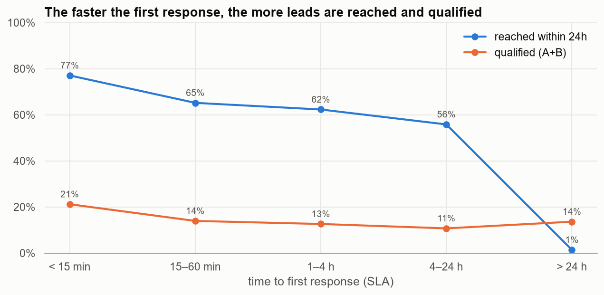

# CRM Analytics for an Online Programming School

End-to-end data analysis of a real CRM export (leads, calls, ad spend and deals) for an online IT school in Germany: data cleaning, exploratory analysis, unit economics, a metric tree and an A/B test design.

**Stack:** Python · pandas · NumPy · matplotlib · seaborn · SciPy · statsmodels · Jupyter · Plotly.js

| | |
|---|---|
| Interactive dashboard | [`reports/dashboard.html`](reports/dashboard.html) |
| Presentation (10 slides, speaker notes included) | [`reports/presentation.pptx`](reports/presentation.pptx) |
| Full report (rendered notebooks) | [`reports/html/`](reports/html) |

## Business question

The school spends about €150k a year on ads and gets about 20k leads. Only 4.2% of them become paying students. **Where are sales lost, and what is the cheapest lever to grow profit?**

## Key results

| Metric | Value |
|---|---|
| Leads (after cleaning) | 19,822 |
| Students | 837 |
| Lead → student conversion (C1) | 4.22% |
| Revenue received | €3.58M |
| CAC | €179 |
| Revenue per student (CLTV) | €4,275 |

1. **Most sales are lost at first contact, not on price.** 40% of lost deals are "doesn't answer / stopped answering".
2. **Speed matters.** Leads answered within 15 minutes are reached by phone 77% of the time, against 52% for slower responses, and are almost twice as likely to be qualified (A/B quality class). The difference is significant (χ², p < 0.001).
3. **Growth broke conversion.** Lead volume tripled over the year while C1 fell from 5–6% to 2.6–3.4%.
4. **Marketing.** Facebook brings the most leads with a CAC of €172. Google Ads converts the same but each lead costs twice as much. One Performance Max campaign spent €34k (23% of budget) and produced 1 student.
5. **Product.** Digital Marketing brings 57% of students. Evening groups convert almost twice as well as morning groups.
6. **Unit economics.** All products are profitable after marketing. +10% to C1 adds €358k contribution margin without extra ad spend.

**Hypothesis and test design:** auto-assign every new lead to a manager within 1 minute and call within 15 minutes. This should raise the 24-hour reach rate by at least 10 percentage points. The test is a 14-day A/B with about 520 leads per group (α = 0.05, power = 80%, two-proportion z-test), followed by a C1 check after 45 days. Expected impact if confirmed: about +€385k contribution margin per year.



## Project structure

```
├── data/
│   ├── raw/              # original CRM exports (xlsx)
│   └── processed/        # cleaned tables (csv for BI tools, pickle for Python)
├── notebooks/
│   ├── 01_data_cleaning.ipynb          # 15 cleaning rules with business justification
│   ├── 02_eda_analysis.ipynb           # descriptive stats, time series, marketing, sales, products, geography
│   ├── 03_unit_economics_ab_test.ipynb # unit economics, sensitivity, metric tree, hypothesis, A/B design
│   ├── *_RU.ipynb                      # original Russian versions of the notebooks
│   └── src_py/                         # the same notebooks as .py (jupytext), easy to diff
├── src/
│   ├── cleaning.py            # reusable ETL: load → clean → save, returns a change log
│   ├── viz.py                 # one chart style for the whole project
│   ├── build_dashboard.py     # builds the self-contained interactive dashboard
│   └── build_presentation.py  # builds the defense deck
└── reports/                   # dashboard, presentation, figures, rendered notebooks
```

## Data cleaning highlights

- Used the **xlsx** exports, not the csv ones. The csv files had lost Cyrillic text and the precision of the 19-digit IDs, which broke the joins between tables.
- Removed 1,771 technical duplicate leads. Fixed impossible dates and payments larger than the course price. Flagged 792 demo accesses.
- Normalised free-text fields: German level (`б1`, `в1`, `B1 (до февраля)` → `B1`), cities, and money (`€ 3.500,00` → `3500.0`).
- Rebuilt **revenue actually received**: first payment plus monthly instalments for the months already studied. The CRM has no single field for it.

## How to run

```bash
pip install -r requirements.txt
python src/cleaning.py                 # raw → data/processed
jupyter lab notebooks/                 # run 01 → 02 → 03
python src/build_dashboard.py
python src/build_presentation.py
```

## Notes

- Final project for the *Python for Data Analysis* and *Product Analytics* courses. The business assumptions follow the client FAQ that came with the task.
- No credentials or API keys are used or stored in this repository.
